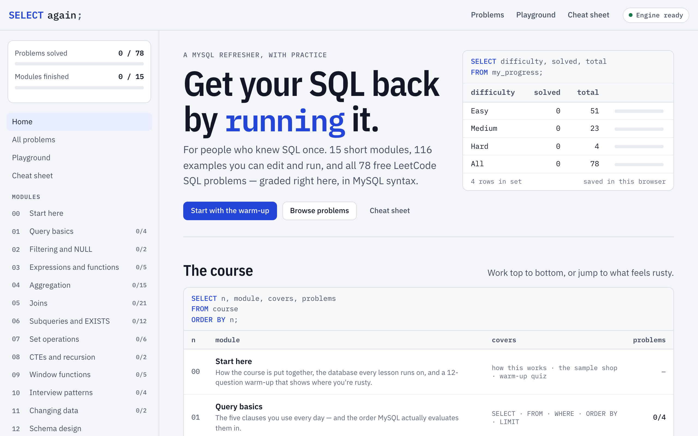

# SELECT Again

**Get your SQL back by running it.** An interactive MySQL refresher for people who knew SQL once: 15 short modules, 116 examples you can edit and run, and all 78 free LeetCode SQL problems, graded right in the page in MySQL syntax.

It's one HTML page. A real SQL engine (SQLite, through sql.js, with a MySQL compatibility layer) runs inside it, so there's nothing to install and no database to set up.

**[Open it now →](https://hossam-04.github.io/select-again/)**



## What's inside

- **15 modules**, each with runnable, editable examples on the same small sample shop database, and a quick check at the end.
- **78 problems**, grouped by module. Each has its tables, an editor, **Run** (your result on the example data) and **Check** (the example data plus hidden edge cases), hints that open one at a time, solutions with alternatives, and **common wrong answers** you can run to see exactly how they fail.
- A **cheat sheet**, a **playground** that lists every table and column, and notes on where the engine differs from MySQL.
- Light and dark themes, readable contrast (WCAG AA), and a phone layout.

| | Module |
|---|---|
| 00 | Start here: how it works, the sample shop, warm-up quiz |
| 01 | Query basics |
| 02 | Filtering and NULL |
| 03 | Expressions and functions |
| 04 | Aggregation |
| 05 | Joins |
| 06 | Subqueries and EXISTS |
| 07 | Set operations |
| 08 | CTEs and recursion |
| 09 | Window functions |
| 10 | Interview patterns |
| 11 | Changing data |
| 12 | Schema design |
| 13 | Indexes and performance |
| 14 | Interview playbook |

## Use it offline

Download [`sql-course.html`](https://hossam-04.github.io/select-again/sql-course.html) and open it in any modern browser. The SQL engine, the editor and the fonts load from cdnjs and Google Fonts, so the first open needs an internet connection.

## Your progress

Solved problems, attempts, drafts, finished modules and quiz scores are saved **in your browser only**, on this device. Nothing is sent anywhere.

To move your progress, for example from the downloaded file to the online version, or to another device: on the home page, under **Your progress**, press **Copy progress code**, then paste the code into the same box on the other copy and press **Import**. Importing merges: it never removes anything you already have.

## Build it from source

The page is built from `course-src/`. You need Node.js.

```bash
cd course-src
npm install
npm run build   # run every example, solution, alternative and wrong answer, then write ../sql-course.html
npm test        # unit tests: the checker, the MySQL compatibility layer, progress codes
npm run e2e     # end-to-end checks in a real browser (Playwright; needs its browsers installed)
```

The build refuses to finish unless every example runs, every solution and alternative passes every test, and every "wrong answer" fails.

- `course-src/content/modules/` – the lessons, in Markdown
- `course-src/content/problems/` – the problems, their tests, hints, solutions and wrong answers
- `course-src/content/sample-db.sql` – the sample shop database
- `course-src/lib/` – the engine wrapper, the MySQL compatibility layer and the result checker
- `course-src/template/` – the page, its styles and its script

## License

- The **code** (everything in `course-src/` except `content/`, plus the SQL examples and solutions inside the lessons) is under the [MIT License](LICENSE).
- The **written course material** (lessons, problem descriptions, hints, explanations, quizzes, the cheat sheet and the sample database) is under [CC BY-NC-SA 4.0](LICENSE-CONTENT): share and adapt it for non-commercial use, with credit, under the same license.

Third-party software and fonts are listed in [THIRD-PARTY-NOTICES.md](THIRD-PARTY-NOTICES.md).

## Credits

Made by [hossam-04](https://github.com/hossam-04). SQL in the browser by [sql.js](https://sql.js.org) and [SQLite](https://sqlite.org). Every problem links to LeetCode, but all descriptions, tables and tests here are original. SELECT Again isn't affiliated with LeetCode.

Its companion is [Sorted Again](https://github.com/hossam-04/sorted-again), the same idea for data structures and algorithms. Both fit into [The Engineer's Syllabus](https://github.com/hossam-04/engineers-syllabus).
